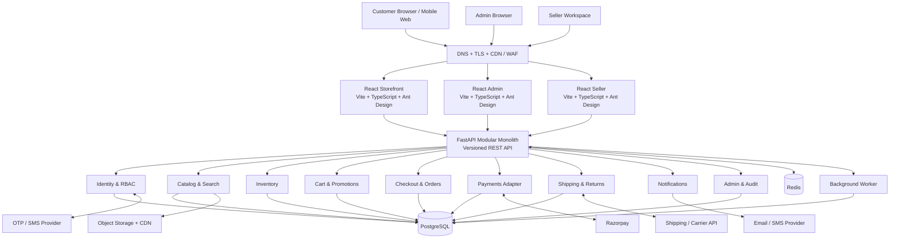
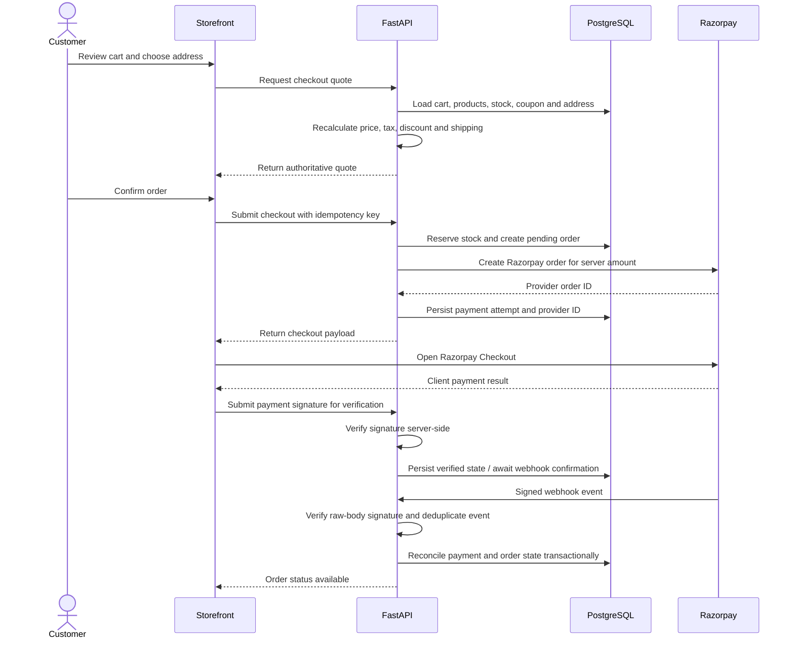
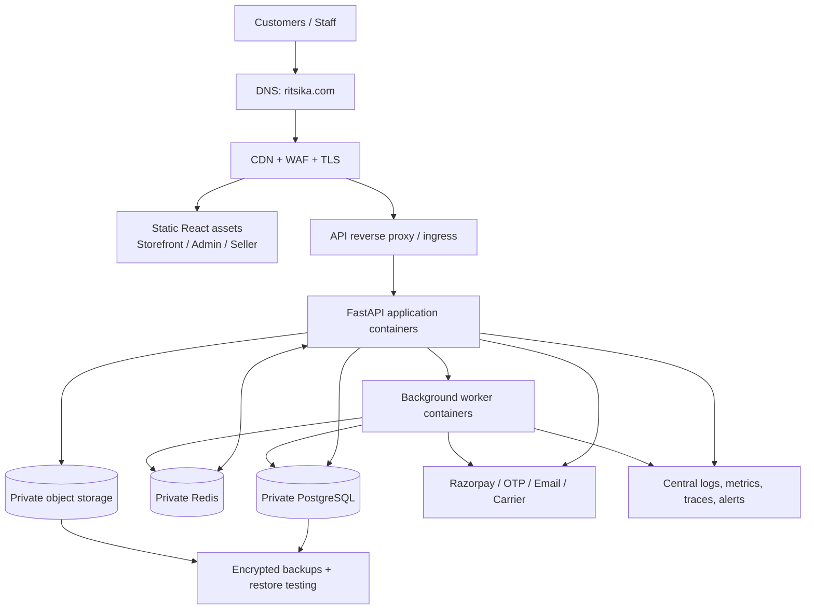

# Ritsika — Complete E-commerce Marketplace Architecture

**Product:** Ritsika (`ritsika.com`)  
**Document status:** Architecture baseline / living design reference  
**Version:** 1.0  
**Last updated:** 5 November 2026  
**Initial operating model:** Single seller, designed to permit a controlled multi-seller evolution  
**Primary market:** India · **Currency:** INR (₹)

> This document is the implementation reference for the Ritsika storefront, operations console, seller workspace, backend, data model, integrations, deployment, security and delivery approach. Update it when a material architecture or product decision changes.

## 1. Executive summary

Ritsika is a premium Indian consumer e-commerce experience positioned around **“A World of Choices”** and **“More than Shopping… It’s a Lifestyle.”** It combines a warm, traditional visual identity with a modern, responsive shopping journey across Fashion, Electronics, Home & Living, Beauty & Care, Kitchen & Dining, Toys & Games, Sports & Fitness, Jewellery and additional categories.

The first release is a **single-seller commerce platform**. The architecture uses a modular-monolith FastAPI backend and three independently deployable React applications in one monorepo:

- **Storefront:** discovery, product detail, cart, checkout, payment and customer order self-service.
- **Admin:** business operations, catalog, inventory, promotions, orders, customers, reports and configuration.
- **Seller workspace:** scaffolded operational boundary; restricted or dormant at single-seller launch. Seller onboarding, commissions and payouts are not launch scope.
- **Backend API:** identity, catalog, pricing, inventory, cart, checkout, orders, payments, shipping, promotions, notifications and administration.
- **Data services:** PostgreSQL as source of truth; Redis for cache, rate limits, short-lived coordination and background-job support.

Avoid premature microservices. Domain boundaries, integration adapters and event/outbox patterns provide a path to scale without introducing distributed-system complexity before it is justified.

## 2. Product and experience principles

1. **Brand-first:** maroon, gold, ivory and warm neutrals are consistent across customer touchpoints.
2. **Trust at every step:** shipping threshold, secure payments, customer support, returns and order status are clear.
3. **Discovery before complexity:** category browsing, search, curated collections and campaign banners help customers reach products quickly.
4. **Mobile-first and responsive:** desktop composition collapses into touch-friendly mobile navigation, cards and checkout steps.
5. **Fast and accessible:** optimized images, lazy loading, keyboard navigation, semantic controls, readable contrast and useful loading/empty/error states.
6. **Server-authoritative commerce:** prices, discounts, tax, stock, shipping charges and payment status are recalculated and validated by the backend.
7. **Operational traceability:** inventory movements, order transitions, payment events and privileged changes are auditable.
8. **Future-ready, not overbuilt:** single seller at launch; preserve extension points for additional sellers without enabling settlement prematurely.

## 3. Brand and UI reference

### 3.1 Supplied visual reference

The supplied image is the visual source of truth for the initial storefront direction and brand presentation.


The image is a composite brand presentation: the **left/main area** illustrates the desktop storefront, while the **right panel** communicates brand identity, colors, values and a mobile mockup. The curved maroon/gold footer belongs to the presentation composition; it should not be copied literally as a fixed page overlay.

### 3.2 Brand system

| Token | Value | Intended use |
|---|---|---|
| Royal Maroon | `#640D14` | Primary brand, header, buttons, active states |
| Golden Touch | `#D4AF37` | Accent, separators, icons, highlights |
| Ivory | `#FFF8F0` | Warm page backgrounds and surfaces |
| White | `#FFFFFF` | Cards, navigation and content surfaces |
| Charcoal | `#292524` | Main text |
| Muted text | `#6B625D` | Secondary text and metadata |
| Soft border | `#E8DDD3` | Dividers, inputs and card outlines |
| Success | `#237A57` | Confirmed states |
| Error | `#B42318` | Validation and destructive states |

**Brand copy**
- Logo/name: **Ritsika**
- Primary tagline: **A World of Choices**
- Campaign line: **Tradition in Every Choice**
- Supporting line: **Shop Smart. Live Better.**
- Lifestyle line: **More than Shopping… It’s a Lifestyle.**
- Values shown in the reference: **Shop Smart · Live Better · Be Happy**

Use official logo artwork as an asset; do not recreate it with generic text in production. Preserve clear space and provide an accessible text alternative.

### 3.3 Desktop storefront composition

The reference desktop layout has these visual zones:

1. **Utility strip:** free shipping above ₹999, secure payments, 24×7 customer support; login/sign-up and cart on the right.
2. **Brand/search row:** large Ritsika logo on the left and prominent product search.
3. **Primary navigation:** Home, Fashion, Electronics, Home & Living, Beauty & Care, More; active item uses a maroon underline.
4. **Category entry:** “All Categories” menu control.
5. **Hero carousel:** warm lifestyle image, campaign headline, supporting copy and “Shop Now” CTA; previous/next controls and pagination.
6. **Category shortcuts:** circular image tiles for Fashion, Electronics, Home & Living, Beauty & Care, Kitchen & Dining, Toys & Games, Sports & Fitness, Jewellery and More.
7. **Service assurances:** Free Shipping Above ₹999, Secure & Easy Payments, Easy Returns Within 7 Days, 24×7 Customer Support.
8. **Campaign cards:** Ethnic Elegance, Latest Tech and Beautiful Homes, each with category-specific imagery and CTA.

Shipping threshold, return window and support availability are configurable business settings, not hard-coded promises. Confirm operational policy, exclusions and terms before displaying them in production.

### 3.4 Responsive behavior

| Area | Desktop | Tablet | Mobile |
|---|---|---|---|
| Utility strip | Full trust messages and account/cart | Condensed messages | Compact announcement strip |
| Header | Logo + wide search + account/cart | Logo + search + icons | Logo + search/cart icons; menu drawer |
| Navigation | Horizontal category links | Scrollable/compact links | Drawer or bottom navigation |
| Hero | Wide image with copy | Cropped image and compact copy | Portrait/square crop, stacked copy, large CTA |
| Categories | Multi-column row | 4–5 columns or scroll | 2–4 columns or horizontal scroll |
| Promotions | Three columns | Two columns | Single-column stack |
| Product grid | 4–5 columns | 2–3 columns | 2 columns; optional list mode |
| Checkout | Multi-column summary | Reduced columns | Step-based single column |

Centralize breakpoints in design tokens and validate with real devices. Do not hide essential price, stock, shipping or checkout information on mobile.

### 3.5 Design-system implementation

Build reusable Ant Design-based components with Ritsika theme tokens:
- `BrandHeader`, `UtilityBar`, `MainNavigation`, `MobileNavigation`
- `GlobalSearch`, `CategoryMenu`, `CategoryTile`
- `HeroCarousel`, `CampaignBanner`, `TrustStrip`
- `ProductCard`, `ProductGrid`, `PriceDisplay`, `RatingSummary`, `StockStatus`
- `QuantitySelector`, `VariantSelector`, `WishlistButton`
- `CartDrawer`, `CartSummary`, `AddressCard`, `CheckoutStepper`
- `OrderStatusTimeline`, `EmptyState`, `ErrorState`, `SkeletonCard`
- `AdminPageShell`, `DataTable`, `FilterBar`, `AuditDetails`

Use CSS variables for brand colors, spacing, typography, shadows and radii. Keep responsive behavior in shared components. Use responsive image sources, modern formats, intrinsic dimensions and lazy loading; serve approved assets through controlled storage/CDN.

## 4. Functional scope

### 4.1 Storefront (customer)

**Discovery:** home, hero campaigns, category hierarchy, breadcrumbs, listing, sorting, filters, search suggestions/results, curated collections and campaign landing pages.

**Product:** title, images, description, specifications, attributes, variants, SKU, availability, delivery estimate, price/MRP/discount/tax display, related and recently viewed products. Ratings/reviews require a moderation and authenticity policy.

**Customer account:** registration, login/logout, OTP verification through an adapter where enabled, profile, addresses, wishlist, order history, order detail, tracking and policy-based cancellation/return requests.

**Shopping:** server-authoritative cart, guest cart reconciliation where supported, coupon validation, shipping estimate, address selection, delivery availability, checkout, Razorpay payment and confirmation/notifications.

### 4.2 Admin console

- Role-protected dashboard and operational KPIs.
- User and role administration.
- Category, product, variant, SKU and media management.
- Inventory levels, adjustments and stock movement ledger.
- Order review, fulfillment, cancellation, return and refund operations.
- Coupons, campaigns, banners and storefront content.
- Shipping rules, serviceability and delivery status.
- Customer support records and account actions.
- Reports/export with permission checks and audit logging.
- System settings and integration configuration; secrets must never be displayed after save.

### 4.3 Seller workspace

The seller app exists as a separate application boundary in the monorepo. For single-seller launch it may be restricted to internal operations or remain disabled. Do not expose public seller registration, seller commissions, settlements or payouts until the operating model changes.

Future multi-seller capabilities would require seller KYC, seller-owned catalog/inventory, commission rules, split fulfillment, settlement ledger, payout reconciliation, seller disputes and tenant isolation. These are not launch requirements.

### 4.4 Initial exclusions / decisions still required

Multi-vendor onboarding and payouts; loyalty/wallet/gift cards; subscription commerce; advanced recommendations; native mobile apps; international currencies; marketplace settlement; review incentives; final shipping/carrier provider and return policy; GST/accounting treatment per product category and registration.

## 5. Logical architecture



### 5.1 Application boundaries

| Application | Responsibility | Deployment |
|---|---|---|
| `apps/storefront` | Public shopping experience | Independent web/static deployment |
| `apps/admin` | Internal operations and reporting | Restricted web deployment |
| `apps/seller` | Future/internal seller workspace | Disabled/restricted until required |
| `backend` | Business rules and API | FastAPI container |
| PostgreSQL | Transactional source of truth | Private database service |
| Redis | Cache, rate limits, ephemeral coordination, job broker | Private cache service |
| Worker | Notifications, exports, cleanup, retryable integration jobs | Separate process/container using backend code |

### 5.2 Backend module boundaries

```text
backend/app/
  api/v1/                 # HTTP routes, request/response schemas
  core/                   # settings, security, logging, exceptions
  db/                     # engine, sessions, base, transaction helpers
  models/                 # SQLAlchemy persistence models
  modules/
    identity/              # users, roles, sessions, OTP
    catalog/               # categories, products, variants, media
    inventory/             # stock, reservations, movements
    pricing/               # price, tax, discounts
    cart/                  # cart and cart items
    promotions/            # coupon and campaign validation
    checkout/              # quote and checkout orchestration
    orders/                # order lifecycle and fulfillment
    payments/              # Razorpay adapter, ledger, webhooks
    shipping/              # serviceability, shipment, tracking
    returns/               # cancellation, returns and refunds
    notifications/         # email/SMS templates and dispatch
    administration/        # dashboards, settings, audit
  integrations/            # razorpay, OTP, messaging, shipping, storage
  workers/                 # asynchronous jobs
  tests/
```

Route handlers validate input, invoke application/domain services and map results to API schemas. Business rules belong in services, not React components or route handlers. Persistence access and transaction boundaries should be explicit.

## 6. Repository structure

```text
ritsika/
  apps/ storefront/ admin/ seller/
  backend/ app/ migrations/ tests/ pyproject.toml Dockerfile
  packages/ ui/ api-client/ config/       # planned shared packages
  docs/
    ARCHITECTURE.md
    IMPLEMENTATION_PLAN.md
    COMPLETE_ARCHITECTURE.md
    assets/ritsika-ui-brand-reference.png
  infra/                                  # planned deployment/monitoring assets
  .github/workflows/                      # planned CI/CD
  docker-compose.yml
  .env.example
  README.md
```

`packages/` and `infra/` are target-state folders and can be introduced as implementation reaches those phases. Pin dependency versions and commit lockfiles for reproducible builds.

## 7. Core data architecture

PostgreSQL is authoritative. Use SQLAlchemy 2.x and Alembic, UUIDs (or another consistent opaque identifier strategy), UTC timestamps, explicit foreign keys, indexes and database constraints. Use `NUMERIC(12,2)` or suitable precision for INR and Python `Decimal`; never use binary floating point for money.

### 7.1 Main entities

| Domain | Main entities | Important rules |
|---|---|---|
| Identity | `users`, `roles`, `user_roles`, `sessions`, `otp_challenges` | Unique normalized email/phone; audit role changes |
| Catalog | `categories`, `products`, `product_variants`, `product_media`, `attributes` | Stable slug/SKU; archive rather than destructive delete where appropriate |
| Inventory | `inventory`, `inventory_movements`, `stock_reservations` | Ledger-backed changes; atomic reservations |
| Pricing | `price_lists` (if needed), `product_prices`, `tax_rates` | Server-authoritative; effective dates where required |
| Cart | `carts`, `cart_items`, `wishlists`, `wishlist_items` | Reprice/revalidate at checkout |
| Promotions | `coupons`, `promotion_rules`, `coupon_redemptions` | Transaction-safe limits and usage |
| Checkout | `checkout_sessions`, `delivery_quotes` | Short-lived; recompute before order creation |
| Orders | `orders`, `order_items`, `order_addresses`, `order_status_history` | Immutable item/address/price/tax snapshots |
| Payments | `payments`, `payment_events`, `refunds`, `payment_reconciliations` | Unique provider IDs; idempotent webhooks |
| Fulfillment | `shipments`, `shipment_events`, `return_requests` | Track fulfillment independently from payment |
| Operations | `audit_logs`, `notification_outbox`, `integration_jobs` | Append-oriented audit/event records |

### 7.2 Entity relationship overview

```mermaid
erDiagram
  USERS ||--o{ USER_ROLES : has
  ROLES ||--o{ USER_ROLES : grants
  CATEGORIES ||--o{ PRODUCTS : groups
  PRODUCTS ||--o{ PRODUCT_VARIANTS : offers
  PRODUCT_VARIANTS ||--o{ INVENTORY : stocked_as
  PRODUCT_VARIANTS ||--o{ INVENTORY_MOVEMENTS : changes
  USERS ||--o{ CARTS : owns
  CARTS ||--o{ CART_ITEMS : contains
  PRODUCT_VARIANTS ||--o{ CART_ITEMS : selected
  USERS ||--o{ ORDERS : places
  ORDERS ||--|{ ORDER_ITEMS : contains
  PRODUCT_VARIANTS ||--o{ ORDER_ITEMS : snapshot_of
  ORDERS ||--o{ PAYMENTS : paid_by
  PAYMENTS ||--o{ PAYMENT_EVENTS : receives
  PAYMENTS ||--o{ REFUNDS : refunded_by
  ORDERS ||--o{ SHIPMENTS : fulfilled_by
  USERS ||--o{ AUDIT_LOGS : actor
```



This is a conceptual map, not a substitute for reviewed Alembic migrations. Add constraints/indexes for normalized email/phone, SKU, slug, provider payment/order/event IDs, order number and frequently filtered status/date columns.

### 7.3 Order and payment state

Keep order, fulfillment and payment states separate. Example states:
- Order: `pending_payment`, `confirmed`, `processing`, `partially_fulfilled`, `fulfilled`, `cancelled`, `completed`.
- Payment: `created`, `pending`, `authorized`, `captured`, `failed`, `partially_refunded`, `refunded`.
- Shipment: `not_created`, `ready_to_ship`, `shipped`, `in_transit`, `delivered`, `exception`, `returned`.

Allow only explicit, validated transitions. Persist transition history with actor, timestamp and reason. Never infer successful payment from a browser redirect.

### 7.4 Inventory consistency

Maintain a movement ledger for receipts, adjustments, reservations, releases, sales and returns. Reserve stock transactionally using row locking or conditional atomic updates. Give reservations an expiry and release safely when checkout/payment expires. Prevent negative stock with database constraints and transaction checks. Ensure duplicate webhook/order processing cannot decrement stock twice.

## 8. API architecture

Expose a versioned REST API under `/api/v1`; publish FastAPI OpenAPI and generate/maintain a typed frontend client where practical.

| Route group | Example endpoints |
|---|---|
| Health | `GET /health`, `GET /ready` |
| Auth | `POST /auth/register`, `/auth/login`, `/auth/refresh`, `/auth/logout`, `/auth/otp/request`, `/auth/otp/verify` |
| Account | `GET/PATCH /me`, `GET/POST /me/addresses` |
| Catalog | `GET /categories`, `GET /products`, `GET /products/{slug}` |
| Search | `GET /search?q=...` |
| Cart | `GET /cart`, `POST /cart/items`, `PATCH /cart/items/{id}`, `DELETE /cart/items/{id}` |
| Wishlist | `GET /wishlist`, `POST /wishlist/items` |
| Checkout | `POST /checkout/quote`, `POST /checkout/confirm` |
| Orders | `GET /orders`, `GET /orders/{order_number}`, `POST /orders/{id}/cancel` |
| Payments | `POST /payments/razorpay/order`, `POST /payments/razorpay/verify`, `POST /webhooks/razorpay` |
| Returns | `POST /orders/{id}/return-requests` |
| Admin | `/admin/products`, `/admin/inventory`, `/admin/orders`, `/admin/users`, `/admin/reports` |

Use consistent pagination, filtering, sorting, error envelopes and request correlation IDs. Validate payload sizes and file types. Avoid exposing internal details or stack traces. Enforce authorization in the backend for every protected operation.

## 9. Checkout and payment flows

### 9.1 Checkout sequence



### 9.2 Payment security requirements

- Create Razorpay orders only from the backend using server-calculated amount and currency.
- Keep API key secret and webhook secret only in server-side secret storage.
- Verify checkout signatures server-side using the provider's documented algorithm.
- Verify webhook signatures against the **raw request body** before parsing/processing.
- Persist provider event IDs with a unique constraint; duplicate delivery must be harmless.
- Use a durable event/inbox or outbox pattern and retry failed processing safely.
- Reconcile payment state with provider APIs for ambiguous/pending outcomes.
- Implement refunds and a refund ledger before live launch.
- Treat frontend callback/redirect as informational, not authoritative.
- Test success, failure, timeout, duplicate/delayed webhook, partial refund and full refund scenarios.

**Launch gate:** do not enable live payments until signature verification, webhook idempotency, payment/order state transitions, reconciliation, refunds and operational alerting are implemented and tested.

## 10. Integrations

Use adapters/interfaces so providers can be replaced without rewriting domain logic.

| Integration | Responsibility | Boundary / safeguards |
|---|---|---|
| Razorpay | Payment order, capture/status, refund, webhook | Backend only; signature verification; idempotency |
| OTP/SMS | OTP delivery and verification support | Adapter; rate limits, expiry, attempt limits |
| Email/SMS | Order, shipment, account notifications | Async jobs, templates, retry and delivery logs |
| Shipping/carrier | Serviceability, shipment, tracking, returns | Adapter; quote validation and event reconciliation |
| Object storage | Product images and documents | Private write credentials, signed uploads, CDN delivery |
| Search | PostgreSQL initial search; external engine only if justified | Search abstraction; avoid premature infrastructure |
| Observability | Logs, metrics, traces and alerts | Redact PII and secrets; correlation IDs |

Never store OTPs in plaintext. Store a short-lived hash or use provider verification. Rate-limit by account, phone, IP and device signals; avoid account-enumeration responses.

## 11. Security, privacy and compliance

Security is a release requirement, not a final cosmetic phase.

### 11.1 Identity and authorization
- Hash passwords with Argon2id using a maintained library and secure parameters.
- Prefer short-lived access tokens and refresh-token rotation/revocation.
- Prefer secure, HttpOnly, SameSite cookies for browser credentials where supported; define CSRF protections for cookie-authenticated mutations.
- Validate token issuer, audience, expiry and signing-key rotation.
- Enforce role and resource-level authorization server-side; do not rely on hidden frontend routes.
- Apply least privilege to customer, admin and future seller roles; require stronger controls for privileged admin actions (MFA where feasible).

### 11.2 Application and infrastructure
- TLS everywhere; enable HSTS after HTTPS is correctly configured.
- Keep PostgreSQL and Redis on private networks; never publish their ports publicly in production.
- Use managed secrets or deployment secret variables; never commit `.env`.
- CORS allowlist contains only approved application origins.
- Add request validation, payload limits, rate limits, secure headers and upload scanning/validation.
- Protect against IDOR, SQL injection, XSS, CSRF, SSRF and mass assignment.
- Pin dependencies, commit lockfiles, scan images/dependencies and patch regularly.
- Run containers as non-root with minimal images and read-only filesystems where practical.

### 11.3 Privacy and operational governance
Collect only data needed to fulfill orders and legal obligations. Define retention, deletion, access and correction processes. Mask phone/email in logs and admin lists where full values are unnecessary. Maintain audit trails for admin changes, refunds, inventory adjustments and sensitive access. Publish accurate Privacy Policy, Terms, Shipping, Cancellation, Return/Refund and Contact pages. Review Indian consumer, tax/GST, payment, data-protection and product-specific obligations with qualified advisors; this is technical guidance, not legal or tax advice.

## 12. Deployment and environments

### 12.1 Environment model
- **Local:** Docker Compose, seeded non-production data and test payment keys.
- **Development:** shared integration environment with isolated credentials and test data.
- **Staging:** production-like topology, HTTPS, payment sandbox, migration rehearsal and end-to-end testing.
- **Production:** hardened images, private data services, backups, monitoring, alerting and controlled deployment.

### 12.2 Target deployment topology



The existing `docker-compose.yml` is for local development and foundation testing. Production needs environment-specific deployment configuration. Do not expose PostgreSQL/Redis ports publicly. Put API and web behind TLS termination/reverse proxy; configure health checks, restart policies, resource limits and persistent volumes.

### 12.3 CI/CD approach
1. Install from lockfiles and cache dependencies safely.
2. Formatting, linting, type checks and unit tests.
3. Backend tests with isolated PostgreSQL/Redis services.
4. Frontend build and component tests.
5. SAST, dependency and container image scanning.
6. Build immutable, version-tagged images.
7. Deploy to staging and run smoke/e2e tests.
8. Approve production promotion; run reviewed migrations as a controlled step.
9. Verify health and key journeys; rollback application image if needed.

Use GitHub Actions or GitLab CI according to the selected repository hosting. Store deployment credentials in CI secrets or OIDC-based short-lived cloud credentials.

## 13. Performance and scalability

- Establish Core Web Vitals and API latency baselines before optimizing.
- Use CDN caching for static assets and public product media.
- Cache safe read-heavy category/navigation/product data with explicit invalidation.
- Never treat Redis as source of truth for orders, payment status or inventory.
- Add indexes based on query plans and observed workload; paginate large lists and avoid ORM N+1 access.
- Use background workers for notifications, exports, image processing and retryable provider calls.
- Add connection pooling and bounded worker concurrency.
- Use database backups, point-in-time recovery where available and periodic restore drills.
- Scale API/worker processes horizontally only after statelessness and shared coordination are validated.
- Introduce dedicated search or split services only when measured workload/team needs justify the operational cost.

## 14. Reliability, observability and support

Use structured JSON logs with timestamp, level, service, environment, request ID and actor ID where appropriate. Redact authorization headers, tokens, OTPs, payment secrets and sensitive personal data.

Track request count/latency/error rate, DB pool and Redis health, queue depth/retries, checkout conversion, payment success/failure, webhook lag, order aging and stock-reservation expiry. Add tracing/correlation across API, worker and provider callbacks where feasible. Alert on webhook failures, reconciliation backlog, failed refunds, inventory anomalies, elevated 5xx, queue backlog and backup failures. Maintain runbooks for payment pending/duplicate, failed shipment, cancellation, refund and stock discrepancy.

## 15. Testing strategy

| Layer | Coverage |
|---|---|
| Backend unit | Pricing, discounts, tax calculations, permissions, state transitions |
| Backend integration | SQL transactions, inventory reservation, auth, Razorpay adapter/webhook |
| Frontend unit/component | Design tokens, responsive components, forms, cart and error states |
| Contract | OpenAPI schemas and generated client compatibility |
| End-to-end | Browse → product → cart → address → checkout → payment sandbox → order tracking |
| Security | Auth bypass, IDOR, CSRF, XSS, rate limits, upload validation, webhook replay |
| Performance | Search/listing, product pages, cart/checkout and admin reporting |
| Operations | Backup/restore, migration rollback plan, worker retry and alert delivery |

Critical commerce operations must test duplicate requests and failure/retry paths.

## 16. Delivery roadmap and acceptance gates

### Phase 1 — Foundation
Monorepo, Docker, React apps, FastAPI, PostgreSQL and Redis; configuration validation, logging, health/readiness, initial Alembic migration, role seed, CI and baseline tests. **Gate:** clean setup, repeatable migrations, all apps build and health checks pass.

### Phase 2 — Identity and access
Registration/login/logout, Argon2id, access/refresh lifecycle, customer/admin RBAC, protected routes, OTP adapter and throttling. **Gate:** authorization/session revocation and OTP abuse tests pass.

### Phase 3 — Catalog and inventory
Category/product/variant CRUD, media, SKU, filters/search, inventory ledger and stock reservation/release. **Gate:** concurrent stock tests prevent oversell; catalog CRUD audited.

### Phase 4 — Shopping and checkout
Cart, wishlist, addresses, coupons, delivery quote, server-side pricing/tax/shipping and immutable snapshots. **Gate:** checkout e2e and transactional rollback pass.

### Phase 5 — Payments and orders
Razorpay create/verify, signed webhook inbox, reconciliation, refund ledger, order/payment state machine and notifications. **Gate:** sandbox matrix passes; no live mode until all payment safeguards pass.

### Phase 6 — Admin and seller
Admin product/order/inventory/promotion/reporting workflows. Seller workspace remains restricted for single-seller launch. **Gate:** admin authorization, audit and operational workflows pass.

### Phase 7 — Production hardening
Security review, load testing, observability, backup/restore, runbooks and legal/policy review. **Gate:** production readiness sign-off.

### Phase 8 — Launch and optimization
Domain/HTTPS, production deployment, monitoring, controlled rollout, support and analytics. **Gate:** monitored launch, tested rollback and incident ownership.

## 17. Architecture decision records (ADRs)

| ID | Decision | Rationale | Revisit when |
|---|---|---|---|
| ADR-001 | Modular monolith backend | Lower operational complexity; clear domain boundaries | Independent scaling/team ownership requires separation |
| ADR-002 | Three React apps in one monorepo | Separate operational surfaces with shared standards | Build/deploy coupling becomes measurable |
| ADR-003 | PostgreSQL is source of truth | Transactions and relational integrity | Not expected for core transactional data |
| ADR-004 | Redis is ephemeral/cache/coordination | Fast cache and job coordination without duplicating truth | Workload needs specialized infrastructure |
| ADR-005 | Single seller initially | Matches confirmed business model | Business explicitly approves multi-seller |
| ADR-006 | Razorpay behind backend adapter | Server-authoritative payment and provider replaceability | Provider/business requirements change |
| ADR-007 | INR-first with Decimal/NUMERIC | Correct money arithmetic for Indian launch | Multi-currency is approved |

## 18. Open decisions register

| Topic | Current baseline | Decision needed |
|---|---|---|
| Shipping threshold | Reference shows free shipping above ₹999 | Confirm threshold, exclusions and zones |
| Returns | Reference shows easy returns within 7 days | Confirm category exclusions, condition and reverse logistics |
| Customer support | Reference says 24×7 | Confirm staffing/channel/SLA before promise |
| Catalog ownership | Single seller | Confirm who creates/approves catalog and stock |
| GST | India-first | Confirm registration, HSN/SAC and category rates with tax advisor |
| OTP | Provider adapter | Select provider, sender ID/template and fallback |
| Shipping provider | Adapter boundary | Select carrier/aggregator and serviceability model |
| Hosting | Dockerized deployment | Confirm cloud, region, managed DB/storage and CI provider |
| Search | PostgreSQL initial search | Define relevance, typo tolerance and external engine threshold |
| Reviews | Not launch-critical | Define verified-purchase and moderation rules |

## 19. Current scaffold status and implementation notes

The repository currently contains the three React/Vite/TypeScript app shells, FastAPI foundation, SQLAlchemy models, Alembic configuration, Docker Compose for local PostgreSQL/Redis/backend/frontends, and the existing concise architecture and implementation plan.

This scaffold is a **foundation, not a production-ready commerce implementation**. Authentication, full catalog/order workflows, initial Alembic revision, payment create/verify, durable webhook idempotency, reconciliation and refunds still need implementation and tests. Review actual code before treating a feature as complete.

### Immediate next engineering tasks
1. Add/review the first Alembic migration; seed roles and validate clean database startup.
2. Add configuration validation, structured logging, request IDs, consistent error handling and CI.
3. Implement identity/RBAC and tests before exposing admin/seller operations.
4. Implement catalog and inventory ledger with concurrency-safe reservations.
5. Implement checkout and Razorpay sandbox flows with durable webhook idempotency, reconciliation and refunds before live payments.
6. Build the storefront against the supplied reference and shared design tokens; validate desktop, tablet and mobile.

## 20. Change management

For every architecture change, update this document and the implementation plan; add an ADR for foundational changes; include migration, rollback and operational impact; add tests for new state transitions and integration failure modes; keep diagrams aligned with deployed reality; and label target-state elements as planned until implemented and tested. Never mark a feature complete solely because a UI placeholder or route exists.
